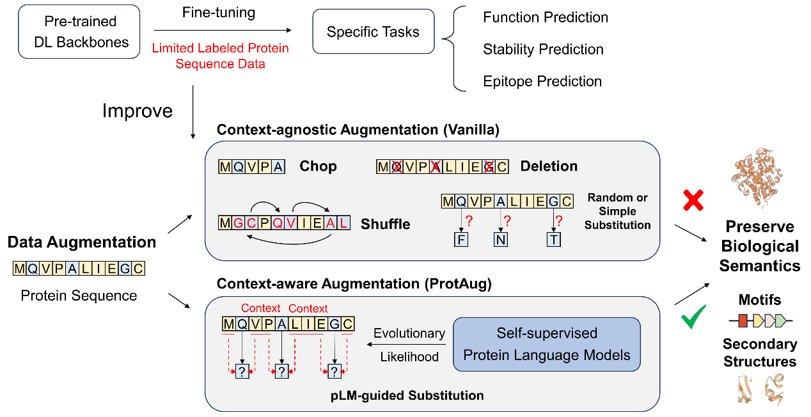
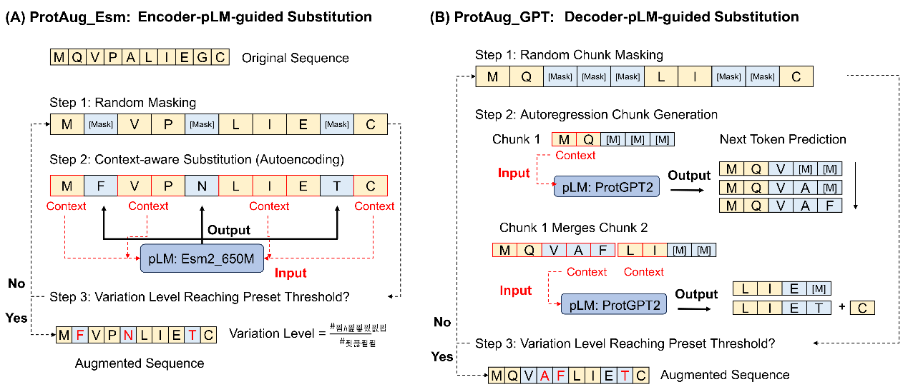

# ProtAug

ProtAug uses pretrained protein language models to augment protein sequences for downstream prediction. Two substitution methods are included:

* **ProtAug_Esm** fills masked residues with ESM-2 (`facebook/esm2_t33_650M_UR50D`).
* **ProtAug_GPT** fills masked spans with ProtGPT2 (`nferruz/ProtGPT2`).

Both methods keep the sequence length fixed and expose a variation level from 0 to about 77%. The release also runs the baselines used in the paper (no augmentation, duplication, random substitution, PAM substitution, and homology retrieval), the sequence-quality metrics, and training/evaluation for five datasets and seven tasks.





Backbones used for fine-tuning are DistilProtBert, ProtBert-BFD, and ESM-2. On an RTX 3090, ProtAug_Esm is among the top two methods on five of the seven tasks at about 10% variation. Low-to-moderate variation (2–30%) is the best default; 55–77% can help some structure tasks. Task scores at 10% variation are in [figures/table1_performance.png](figures/table1_performance.png). The other result figures from the manuscript are in `figures/`.

## Environment

Experiments were run on one NVIDIA RTX 3090 (24 GB) with CUDA 12.8.

* Python 3.12
* TensorFlow 2.19.0
* PyTorch 2.7.1
* `transformers`, `ktrain`, pandas, numpy, scipy, scikit-learn

```bash
conda env create -f environment.yml
conda activate protaug
```

or `pip install -r requirements.txt`.

`ktrain` needs two local edits before ESM-2 fine-tuning:

1. `ktrain/text/preprocessor.py`: skip the default text length check so protein slices can be tokenized.
2. `ktrain/lroptimize/triangular.py`: replace `np.Inf` with `np.inf`.

ProtAug_GPT and secondary-structure training use PyTorch. The other fine-tuning scripts use TensorFlow and ktrain. Backbone weights stay frozen unless a script is passed `--unfreeze_plm`.

## Models

Download the encoder checkpoints into `Models/`, or let the scripts pull them from Hugging Face. See [Models/README.md](Models/README.md).

```bash
huggingface-cli download facebook/esm2_t33_650M_UR50D --local-dir Models/Esm2
huggingface-cli download Rostlab/prot_bert_bfd --local-dir Models/prot_bert_bfd
huggingface-cli download yarongef/DistilProtBert --local-dir Models/DistilProtBert
```

ProtGPT2 (`nferruz/ProtGPT2`) is downloaded on first use. Checkpoints are not stored in git.

## Layout

| Path | Role |
| --- | --- |
| `Function_MF/` | Molecular-function prediction (Fmax) |
| `Stability/` | Thermostability, Novozymes (Spearman) |
| `Epitope/` | Epitope prediction (AUC) |
| `RemoteHomology/` | Family, superfamily, and fold (accuracy) |
| `SecondaryStructure/` | 3-state secondary structure (accuracy) |
| `metrics/quality.py` | Variation, repetition, Shannon diversity |
| `protaug_paths.py` | Local checkpoint or Hugging Face id |
| `figures/` | Figures extracted from the manuscript |

Each task directory is self-contained. Run commands from that directory. `--test` keeps the first few sequences so a command can be checked before a full run. Drop `--test` for the full split.

Augmented CSVs, embeddings, and weight files are written next to the scripts and are gitignored.

## Datasets

The seven tasks and the files shipped in this repo:

| Task | Train | Valid | Test | Metric | Files |
| --- | ---: | ---: | ---: | --- | --- |
| Function_MF | 32421 | 3587 | 1137 | Fmax | `Function_MF/data/mf-{training,validation,test}.csv` |
| Stability | 25112 | 4708 | 1570 | Spearman | `Stability/data/{train,val,test}_split.csv` |
| Epitope | 532 | 152 | 77 | AUC | `Epitope/data/{train,val,test}_split.csv` |
| Family | 12312 | 736 | 1272 | Accuracy | `RemoteHomology/data/*_family.csv` |
| Superfamily | 12312 | 736 | 1254 | Accuracy | `RemoteHomology/data/*_superfamily.csv` |
| Fold | 12312 | 736 | 718 | Accuracy | `RemoteHomology/data/*_fold.csv` |
| Secondary structure | 8678 | 2170 | 513 | Accuracy | `SecondaryStructure/data/{train,valid,test}.csv` |

Sources:

* Function_MF follows the TEMPROT molecular-function split ([doi:10.1186/s12859-023-05375-0](https://doi.org/10.1186/s12859-023-05375-0)). `Function_MF/go.obo` is the Gene Ontology used by the Fmax evaluator.
* Stability is the Novozymes Enzyme Stability Prediction set. `test_split.csv` is the held-out split read by the training scripts. `test.csv` and `test_labels.csv` are the 2413-sequence competition test. Table 3 of the paper lists 6278 validation sequences, which is `val_split` plus `test_split` (4708 + 1570), and 2413 test sequences.
* Epitope peptides are from the [Future Corporation epitope dataset](https://www.kaggle.com/datasets/futurecorporation/epitope-prediction), split 7:2:1 by protein. `input_bcell.csv` and `input_sars.csv` hold the peptide coordinates used during fine-tuning. These files have 532 / 152 / 77 proteins; Table 3 lists 533 / 153 / 78.
* Family, superfamily, fold, and secondary structure are the TAPE splits ([tape](https://github.com/songlab-cal/tape)). Secondary-structure labels are 3-state (`y ∈ {0,1,2}`). `cb513.csv` is the same 513-sequence test set under the CB513 name.

Average lengths in the paper are 554, 446, 572, 167, 168, 160, and 256 amino acids for the seven tasks in the table order above.

## Baselines

No augmentation and duplication are flags on the fine-tuning scripts (`--method noaug` and `--method duplicate`). Random and PAM substitutions are `data-augmentation.py`. Homology retrieval is `homology.py` and needs a DIAMOND search (below).

Realized variation is lower than the nominal `k` when a draw copies the original residue. The settings below are the ones used for about 10% Hamming distance. Check the realized level with `metrics/quality.py`.

Function_MF names the uniform baseline `Random`. The other tasks name it `Identity` (`Identity.npy` is a flat 20×20 matrix). PAM1 is built into the script. PAM50 and PAM250 read `PAM50.npy` and `PAM250.npy`.

```bash
cd Function_MF
python data-augmentation.py --method Random --k 0.023 --test
python data-augmentation.py --method PAM1 --k 10 --test

cd ../Stability   # or Epitope, RemoteHomology, SecondaryStructure
python data-augmentation.py --method Identity --k 0.023 --test
python data-augmentation.py --method PAM1 --k 10 --test
```

Remote homology writes one augmented table per label file:

```bash
cd RemoteHomology
python data-augmentation.py --method Identity --k 0.023 --input data/train_family.csv --test
python data-augmentation.py --method Identity --k 0.023 --input data/train_superfamily.csv --test
python data-augmentation.py --method Identity --k 0.023 --input data/train_fold.csv --test
```

## ProtAug_Esm

`MLMgenerator.py` masks residues and fills them with the encoder MLM. At each chosen site the input follows the BERT corruption used in the paper: 80% `[MASK]`, 10% a random amino acid, 10% unchanged. The fill is the argmax token.

`Function_MF`, `RemoteHomology`, and `SecondaryStructure` take a target variation `--rho`. `Stability` and `Epitope` take `--k` (the same iterative mask fraction; their result files use the `k` name). `--num_chunk` splits the table so several processes can run, and `df_merge.py` concatenates the chunks.

```bash
cd Function_MF
python MLMgenerator.py --model Esm2 --rho 0.10 --test

# full data, five chunks
python MLMgenerator.py --model Esm2 --rho 0.10 --num_chunk 5 --chunk_id 0
python df_merge.py Esm2_MLM_rho0.10 5
```

```bash
cd Stability          # Epitope uses the same flags
python MLMgenerator.py --model Esm2 --k 0.10 --test
python df_merge.py data/aug_Esm2_MLM_k0.10 5

cd ../RemoteHomology
python MLMgenerator.py --model Esm2 --rho 0.10 --input data/train_family.csv --test
python MLMgenerator.py --model Esm2 --rho 0.10 --input data/train_superfamily.csv --test
python MLMgenerator.py --model Esm2 --rho 0.10 --input data/train_fold.csv --test
python df_merge.py data/aug_Esm2_MLM_rho0.10 5

cd ../SecondaryStructure
python MLMgenerator.py --model Esm2 --rho 0.10 --test
python df_merge.py data/aug_Esm2_MLM_rho0.10 5
```

`--model` is `Esm2`, `prot_bert_bfd`, or `DistilProtBert`. Other variation levels used in the paper are 0.02, 0.30, 0.55, and 0.77.

## ProtAug_GPT

`ProtGPT2generator.py` masks contiguous chunks and asks ProtGPT2 to rewrite them (`do_sample=True`, `top_k=950`, `repetition_penalty=1.2`). Newline tokens are replaced with leucine. Sequences are sliced at 1000 residues because ProtGPT2 is run under a 1280-token limit.

```bash
cd Function_MF
python ProtGPT2generator.py --model ProtGPT2 --rho 0.10 --test
python ProtGPT2generator.py --model ProtGPT2 --rho 0.10 --num_chunk 5 --chunk_id 0
python df_merge.py ProtGPT2_rho0.10 5

cd ../Stability          # Epitope is the same; the flag is --k
python ProtGPT2generator.py --k 0.10 --test

cd ../RemoteHomology
python ProtGPT2generator.py --rho 0.10 --input data/train_fold.csv --test

cd ../SecondaryStructure
python ProtGPT2generator.py --rho 0.10 --test
```

## Sequence-quality metrics

Normalized Hamming distance, triplet repetition, and Shannon diversity:

```bash
python ../metrics/quality.py variation \
  --d1 data/mf-training.csv \
  --d2 data/mf-augmented_training_Esm2_MLM_rho0.10.csv
python ../metrics/quality.py repetition data/mf-augmented_training_Esm2_MLM_rho0.10.csv
python ../metrics/quality.py shannon data/mf-augmented_training_Esm2_MLM_rho0.10.csv
```

Run that from the task directory and point `--d1` / `--d2` at the original and augmented CSVs. The sequence column may be `sequences`, `protein_sequence`, or `protein_seq`. `Function_MF/count_diff.py`, `cal_rep_ratio.py`, and `cal_shannon.py` are the same three scores for tables that use a `sequences` column.

Fmax (Function_MF) is implemented in `Function_MF/evaluate.py` and called by `meta-classifier.py`. Spearman, AUC, and accuracy are computed inside the task scripts below.

## Training and evaluation

Fine-tuning trains a task head on frozen pLM features. Function, stability, and remote homology then pool slice embeddings and train a small meta-classifier. Epitope and secondary structure score the head directly.

### Function_MF

Fmax over 677 molecular-function terms. Slices are 500 residues with 250 overlap. The meta-classifier is a one-hidden-layer MLP (1000 units, learning rate 1e-3, batch 32).

```bash
cd Function_MF
CUDA_VISIBLE_DEVICES=0 python fine-tuning-fix.py --model Esm2 --method noaug --batch 4 --lr 1e-4 --test
CUDA_VISIBLE_DEVICES=0 python fine-tuning-fix.py --model Esm2 --method duplicate --batch 4 --lr 1e-4 --test
CUDA_VISIBLE_DEVICES=0 python fine-tuning-fix.py --model Esm2 --method aug --augfile _Esm2_MLM_rho0.10 --batch 4 --lr 1e-4 --test

CUDA_VISIBLE_DEVICES=0 python extract-embeddings.py --model_name Esm2 --model_path fix_weights/Esm2-finetune-noaug/test --noaug --output Esm2-fix-noaug --test
CUDA_VISIBLE_DEVICES=0 python extract-embeddings.py --model_name Esm2 --model_path fix_weights/Esm2-finetune-aug_Esm2_MLM_rho0.10/test --augfile _Esm2_MLM_rho0.10 --output Esm2-fix-Esm2_MLM_rho0.10 --test

python meta-classifier.py --embedding Esm2-fix-Esm2_MLM_rho0.10 --noaug --test
python meta-classifier.py --embedding Esm2-fix-Esm2_MLM_rho0.10 --only_aug --test
python meta-classifier.py --embedding Esm2-fix-Esm2_MLM_rho0.10 --test
```

### Stability

Spearman correlation of predicted and measured melting temperature. Same slicing as Function_MF. The meta-classifier is a regression MLP with hidden sizes 500 and 50.

```bash
cd Stability
CUDA_VISIBLE_DEVICES=0 python fine-tuning.py --model Esm2 --method noaug --batch 4 --lr 1e-5 --test
CUDA_VISIBLE_DEVICES=0 python fine-tuning.py --model Esm2 --method aug --augfile _Esm2_MLM_k0.10 --batch 4 --lr 1e-5 --test
CUDA_VISIBLE_DEVICES=0 python extract-embeddings.py --model_name Esm2 --model_path weights/Esm2-finetune-aug_Esm2_MLM_k0.10 --augfile _Esm2_MLM_k0.10 --output Esm2-aug --test
python meta-classifier.py --embedding Esm2-aug --test
```

`meta-classifier.py` prints Spearman on the split selected by `--testset` (`train`, `val`, or `test`). The default test file is `data/test_split.csv`.

### Epitope

AUC on peptide records. Each example is a segment of at most 500 residues centered on the peptide, and `token_type_ids` marks the peptide span. The head is a 3-layer MLP (256, 32) trained end to end at learning rate 1e-4 and batch size 4. There is no meta-classifier step.

```bash
cd Epitope
CUDA_VISIBLE_DEVICES=0 python fine-tuning.py --model Esm2 --method noaug --batch 4 --lr 1e-4 --test
CUDA_VISIBLE_DEVICES=0 python fine-tuning.py --model Esm2 --method aug --augfile _Esm2_MLM_k0.10 --batch 4 --lr 1e-4 --test
```

The log written by `fine-tuning.py` includes `roc_auc`.

### Remote homology

Accuracy at family (3888 classes), superfamily (1961), and fold (1195). Set `--label` to `family`, `superfamily`, or `fold`. The meta-classifier is an MLP with 1200 hidden units, learning rate 1e-4, and batch size 32.

```bash
cd RemoteHomology
CUDA_VISIBLE_DEVICES=0 python extract-embeddings.py --model_name Esm2 --label family --noaug --output Esm2-family-noaug --test
python meta-classifier.py --label family --embedding Esm2-family-noaug --noaug --test

CUDA_VISIBLE_DEVICES=0 python extract-embeddings.py --model_name Esm2 --label fold --augfile _Esm2_MLM_rho0.10 --output Esm2-fold-aug --test
python meta-classifier.py --label fold --embedding Esm2-fold-aug --test
```

Repeat with `--label superfamily`. The augmented CSV must be the one produced from the matching `train_<label>.csv`, so that the label column agrees with the task.

### Secondary structure

Per-residue 3-state accuracy. The head is an MLP with hidden sizes 512 and 256, learning rate 1e-3, and batch size 16. `fine-tuning.py` trains and reports accuracy on `data/valid.csv` and `data/test.csv`.

```bash
cd SecondaryStructure
CUDA_VISIBLE_DEVICES=0 python fine-tuning.py --model Esm2 --method noaug --batch_size 16 --learning_rate 1e-3 --epochs 1 --test
CUDA_VISIBLE_DEVICES=0 python fine-tuning.py --model Esm2 --method aug --augfile data/aug_Esm2_MLM_rho0.10.csv --batch_size 16 --learning_rate 1e-3 --test
```

## Homology baseline

`homology.py` builds an augmented training set from DIAMOND hits in Swiss-Prot. A hit is kept when its sequence identity is at most `1 - rho`. Proteins with no hit can fall back to a random-substitution row (`--random`). The Swiss-Prot FASTA and DIAMOND database are not in this repo (each copy is about 200 MB).

```bash
# from a task directory, after building data/training_uniprot_tvt.txt
python homology.py --rho 0.10 \
  --input data/training_uniprot_tvt.txt \
  --uniprot data/uniprot_filt_tvt.fasta \
  --data data/train.csv \
  --random data/aug_Identity_k0.023.csv \
  --output data/aug_homology_rho0.10.csv
```

`--higher` keeps the closer hits (HomologyTop in the paper). Function_MF passes its own training CSV as `--data`.

## Citation

ProtAug: An Empirical Investigation of pLM-Guided Data Augmentation for Protein Sequence Prediction Tasks. Zhuoyang Chen, Ruoqi Wang, Qiong Luo.
